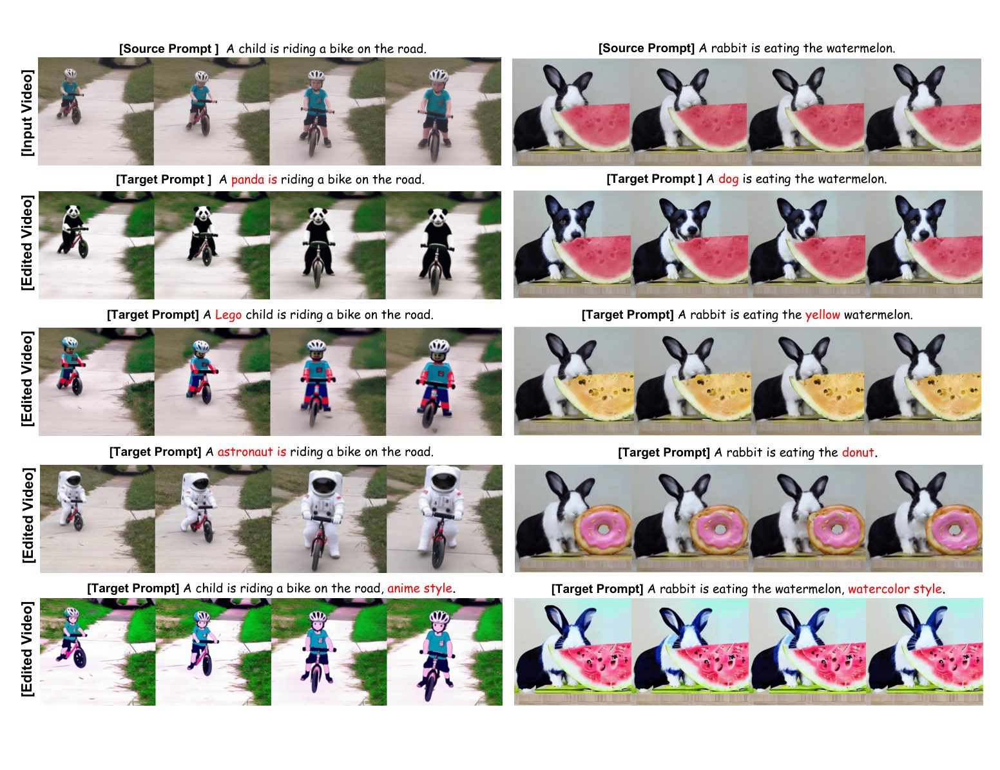
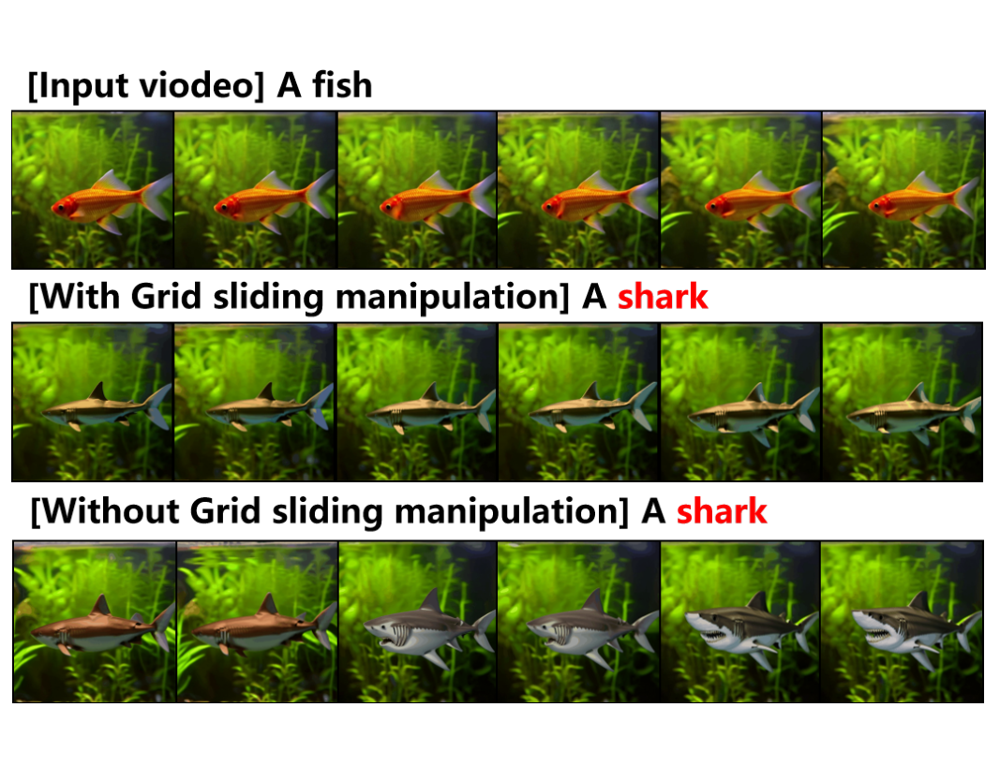
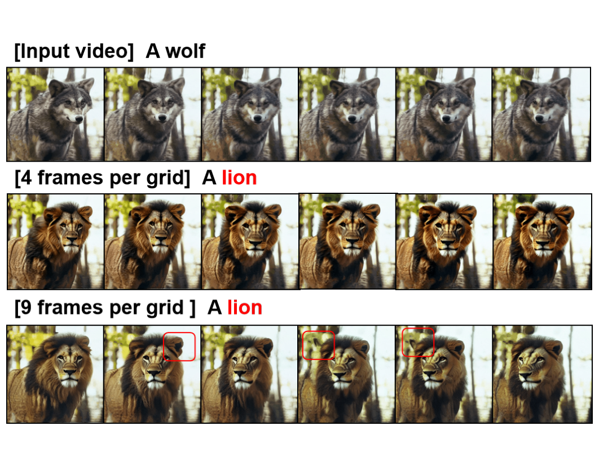

# LLM-Driven Unified Framework with Grid Diffusion for Efficient Long Video Editing (UELVE)

Official repository of **"LLM-Driven Unified Framework with Grid Diffusion for Efficient Long Video Editing"**.

UELVE is an LLM-driven unified framework for efficient long-video editing built on pre-trained text-to-image diffusion models: an LLM adaptively decides editing strategies by analyzing source/target prompts, frames are organized into grids for sequential grid-based diffusion (grid self-attention for short-term consistency), and a grid sliding mechanism maintains long-term consistency — with natural multi-GPU parallel inference and minimal inter-GPU communication.

<p align="center">
  
</p>
<p align="center"><i>Framework of UELVE. We first arrange the frames of input video V<sub>K</sub> into
grids, encode them into the latent space and then invert the original latents to Z<sub>T</sub>. Then we
denoise the grid latents Z<sub>T</sub> to Ẑ<sub>0</sub> via T time steps of iterations on a pre-trained
Text-to-Image diffusion model, decode Ẑ<sub>0</sub> and rearrange the resulted grid frames into an
edited video V̂<sub>K</sub> as output. For the denoising process, by comparing the source and target
prompts, we leverage an LLM to reason out specific editing goals and types and thus make decisions on
corresponding model adaptions, unifying diverse editing tasks into a same framework. Beyond the grid
self-attention for within-grid interactions, we perform a grid sliding manipulation to enhance
cross-grid interactions to maintain long-term consistency. Benefiting from the flexible grid
manipulations, a multi-GPU data parallel computing strategy is also considered to remarkably improve
the computation efficiency.</i></p>

## 🔗 Links

- **[📄 arXiv](https://arxiv.org/abs/XXXX.XXXXX)** — Coming Soon
- **[🌐 Project Page](https://lily-qaq.github.io/UELVE/)**
- **🤗 Demo** — Coming Soon
- **🗂️ DataSets** — Coming Soon
- **🧱 Model Weights** — Coming Soon

## 📰 News

- **[2026/10/18]** Project page released.
- **[2026/9/13]** Major revision.
- **[2026/7/31]** Paper submitted.

## 🚀 Quick Start

<!-- TODO: fill in once the code is released -->

### 1. Environment

```bash
# Example: adjust dependencies to your actual setup
conda create -n uelve python=3.10 -y
conda activate uelve
pip install -r requirements.txt
```

### 2. Run

```bash
# TODO: minimal reproducible command
python run.py --source_video examples/wolf.mp4 --target_prompt "..."
```

## 📊 Main Results

<p align="center">
  
</p>

UELVE is an efficient long-video editing method that leverages LLM to make decisions on model adaptions
according to specific editing types, implements grid diffusion on a pre-trained Text-to-Image model to
maintain short-term and long-term consistencies, and enhances the efficiency by multi-GPU data
parallel computation. It is applicable to diverse editing tasks, including object/background
replacement, local editing of attributes (style, color, shape), global style transformation and even
motion editing.

### Ablation Studies

- **Grid sliding manipulation.** Without grid sliding, the same object (e.g., a shark) drifts into inconsistent shapes across grids; with grid sliding, shapes stay consistent across grids — confirming its necessity for inter-grid and long-term consistency.
- **Grid size.** A larger grid captures more global context but yields coarser details: a 3×3 grid improves overall semantic consistency and shape fidelity over 2×2, yet introduces detail artifacts (e.g., blurred or abnormally folded ears), so grid size trades global context against local detail.

<table align="center">
  <tr>
    <td></td>
    <td></td>
  </tr>
</table>

More results and analysis are provided in the [project page](https://lily-qaq.github.io/UELVE/) and the paper.

## 📚 Citation

If you find this work helpful, please cite:

```bibtex
@article{liu2026uelve,
  author    = {Liu, Deyin and He, Li and Li, Zhan and Liang, Chengwu},
  title     = {LLM-Driven Unified Framework with Grid Diffusion for Efficient Long Video Editing},
  journal   = {arXiv preprint arXiv:XXXX.XXXXX},
  year      = {2026}
}
```

## 🙏 Acknowledgements

The project page is built on the [Nerfies](https://nerfies.github.io/) template.

## ⚖️ License

TODO: choose a license (MIT / Apache-2.0) and add a LICENSE file.
