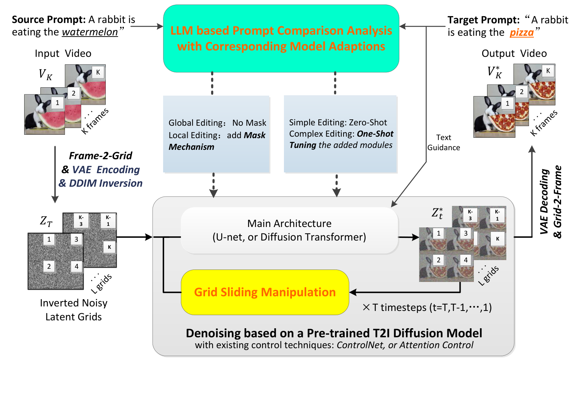

# LLM-Driven Unified Framework with Grid Diffusion for Efficient Long Video Editing (UELVE)

Official repository of **"LLM-Driven Unified Framework with Grid Diffusion for Efficient Long Video Editing"**.

UELVE is an LLM-driven unified framework for efficient long-video editing built on pre-trained text-to-image diffusion models: an LLM adaptively decides editing strategies by analyzing source/target prompts, frames are organized into grids for sequential grid-based diffusion (grid self-attention for short-term consistency), and a grid sliding mechanism maintains long-term consistency — with natural multi-GPU parallel inference and minimal inter-GPU communication.

<p align="center">
  
</p>
<p align="center"><i>Framework of UELVE: frames are arranged into grids for sequential grid-based
diffusion on a pre-trained Text-to-Image model, with an LLM adaptively deciding editing strategies,
grid self-attention for short-term consistency, a grid sliding mechanism for long-term consistency,
and multi-GPU data parallel inference.</i></p>

## 🔗 Links

- **[📄 arXiv](https://arxiv.org/abs/XXXX.XXXXX)** — 【TODO: arXiv 挂出来后更新】
- **[🌐 Project Page](https://lily-qaq.github.io/UELVE/)** — 在线演示与更多结果
- 【可选:🤗 Demo / 数据集 / 模型权重链接】

## 📰 News

- **[2026/XX/XX]** 【TODO: 录用消息,如 "🎉 论文被 XX 接收"】
- **[2026/XX/XX]** 项目主页上线。
- **[2026/XX/XX]** 论文投稿/preprint。

## 🚀 Quick Start

<!-- TODO: 按代码发布情况填写 -->

### 1. 环境

```bash
# 示例:按实际依赖改
conda create -n uelve python=3.10 -y
conda activate uelve
pip install -r requirements.txt
```

### 2. 运行

```bash
# TODO: 最小可复现命令
python run.py --source_video examples/wolf.mp4 --target_prompt "..."
```

## 📊 Main Results

<!-- TODO: 主结果表(数据见论文实验部分) -->

| Method | Editing Quality | Temporal Consistency | Time (s) | Memory (GB) |
|:---|:---:|:---:|:---:|:---:|
| Baseline | - | - | - | - |
| **UELVE** | **-** | **-** | **-** | **-** |

更多结果、消融实验与多 GPU 加速分析见[项目主页](https://lily-qaq.github.io/UELVE/)和论文。

## 📚 Citation

如果这个工作对你有帮助,欢迎引用:

```bibtex
@article{liu2026uelve,
  author    = {Liu, Deyin and He, Li and Li, Zhan and Liang, Chengwu},
  title     = {LLM-Driven Unified Framework with Grid Diffusion for Efficient Long Video Editing},
  journal   = {arXiv preprint arXiv:XXXX.XXXXX},
  year      = {2026}
}
```

## 🙏 Acknowledgements

项目主页基于 [Nerfies](https://nerfies.github.io/) 模板构建。

## ⚖️ License

【TODO: 选择许可证(MIT / Apache-2.0),并添加 LICENSE 文件。】
